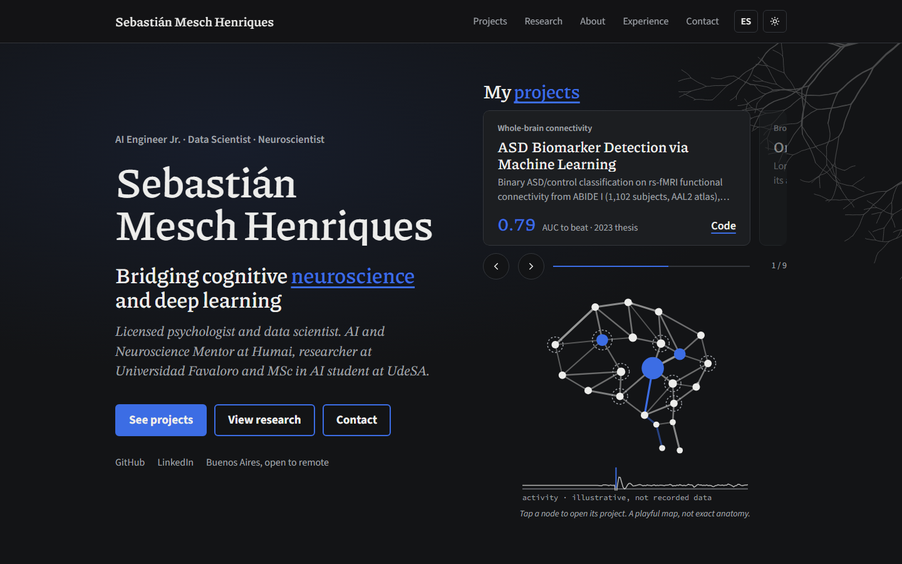
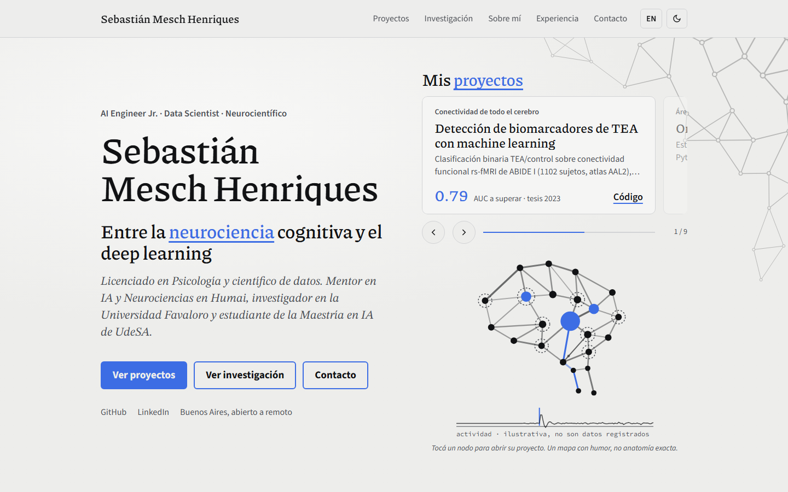
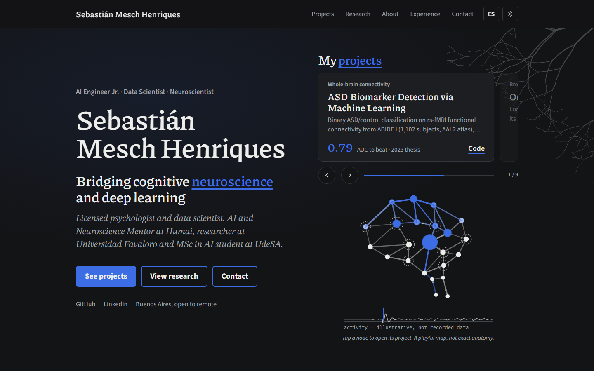
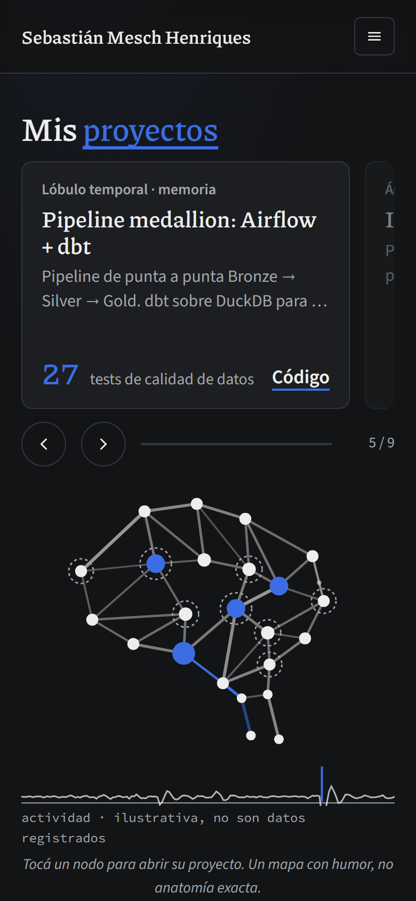

# Implementación del rediseño (14/11/2026)

Rama `prototipo-portada`, sin commits. Reemplaza al refactor de React a medio hacer y al `index.html` viejo, con todo el contenido del sitio publicado.

## Qué quedó

- **Portada:**
  - a la izquierda, el nombre (sube línea por línea), la frase con la palabra clave subrayada, la bajada en STIX itálica y los botones;
  - a la derecha, "My projects": el carrusel en fila (alto fijo, avanza solo cada 6 s, se arrastra) y, abajo, el cerebro interactivo con la semilla de conectividad y el registro de actividad.
- **Fondo:** dendritas en oscuro y red de nodos en claro, con crecimiento lineal desde la esquina.
- **Secciones:** proyectos (9), docencia e investigación, sobre mí (con el resaltador recto), experiencia, formación y certificaciones, y contacto (FormSubmit, como antes).
- **Idioma:** inglés y español con un botón. Sin nada guardado, sigue el idioma del navegador.
- **Tema:** claro y oscuro con un botón. Sin nada guardado, sigue al sistema, sin destello al cargar.
- **Celular:** menú desplegable, y el cerebro después del carrusel.
- **Accesibilidad:** foco visible, enlace para saltar al contenido, carrusel con roles y anuncios solo cuando lo maneja la persona, nodos del cerebro operables con teclado, y movimiento reducido en todo.
- **Tests:** 33 (grafo del cerebro, crecimiento del fondo, preferencias, resaltador, paridad de los textos EN/ES y de los proyectos). Corren también en el workflow de deploy.
- **Seguridad:** ver `docs/seguridad-pre-lanzamiento.md`. Sin P0.

## Cambios de contenido para que revises

Partí del texto que se ve hoy en vivo (el diccionario de traducciones del `index.html` de `main`, que pisa el HTML al cargar). Cambié:

1. **"Academic Coordinator at Humai" → "AI and Neuroscience Mentor at Humai"** en la portada, como dicen tu Experience, tu About y la versión en español. Si el correcto es el otro, se cambia en `src/contenido/textos.ts`.
2. **La cifra de la tesis:** "0.79 · AUC to beat · 2023 thesis".
   - El 0.79 es el benchmark histórico de la tesis 2023 con regresión logística L2 (README de ASD-detection).
   - Los modelos actuales del repo dan 0.709 a 0.736.
   - La frase vieja ("Benchmarked at AUC 0.79, exploring MLP and GNN") daba a entender que MLP o GNN llegaban a 0.79.
3. **Sin "at the intersection of"** (está en tu lista negra de escritura de IA): en la bajada de Research y en el About ("My main interest is AI for mental health").
4. **Un solo resaltador** (en "AI for mental health"). Las otras negritas del About salieron, porque el gusto permite uno o dos resaltados por página.
5. **Traducciones nuevas al español** de lo que en el sitio actual quedaba en inglés: Ontogenia, ABIDE DANN y las regiones del mapa.
6. **"New Frontiers in Neuroscience · INECO" sin enlace:** apuntaba al artículo de SciELO por error. Si tenés el enlace correcto, va en `src/contenido/trayectoria.ts`.
7. **Pendiente de antes:** en SciELO, la revista figura como *Psicologia & Sociedade*; en el sitio dice "Psicología y Sociedad".

## Cómo seguir

- **Ver en vivo:**
  - desarrollo: `npm run dev`;
  - build de producción: `npm run build && npx vite preview`.
- **Publicar:** el workflow `.github/workflows/deploy.yml` construye y publica en GitHub Pages cuando se pushea a `main`. Hoy `main` tiene el sitio viejo (un `index.html` suelto), así que publicar es mergear esta rama a `main` y confirmar en Settings → Pages que la fuente sea "GitHub Actions".
- **Editar textos:** `src/contenido/` (`textos.ts`, `proyectos.ts`, `trayectoria.ts`). Los tests avisan si falta una traducción.
- El prototipo de las variantes quedó como referencia en `../prototipo-2/codigo/` (no se compila).
